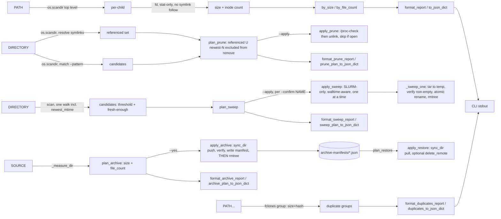

# scitex-storage

<p align="center">
  <a href="https://scitex.ai">
    
  </a>
</p>

<p align="center"><b>Research-data storage triage — a read-only, stat-only scan (via <code>fd</code>) that finds the biggest space and inode (file-count) consumers on your disk, safe rotation (referenced-file-aware for build artifacts, compute-node-only tar-in-place for HPC inode hogs), copy-verify-then-remove tiering to NAS, and an opt-in exact-duplicate finder (via <code>fclones</code>).</b></p>

<p align="center">
  <a href="https://scitex-storage.readthedocs.io/">Full Documentation</a> · <code>pip install scitex-storage</code>
</p>

<!-- scitex-badges:start -->
<p align="center">
  <a href="https://pypi.org/project/scitex-storage/"></a>
  <a href="https://pypi.org/project/scitex-storage/"></a>
  <a href="https://github.com/scitex-ai/scitex-storage/actions/workflows/ci.yml"></a>
  <a href="https://scitex-storage.readthedocs.io/en/latest/"></a>
</p>
<p align="center">
  <a href="https://codecov.io/gh/scitex-ai/scitex-storage"></a>
</p>
<!-- scitex-badges:end -->

---

## Problem and Solution

| # | Problem | Solution |
|---|---------|----------|
| 1 | **Disk full, culprit unknown** — `du -sh *` storms the filesystem and follows symlinks onto slow network mounts | **`scitex-storage scan`** — a read-only, stat-only walk (via `fd`) that reports total **bytes per top-level child**, sorted biggest-first, never following symlinked dirs |
| 2 | **Inodes exhausted, disk looks free** — `No space left on device` with GBs free: `du` measures bytes, not the millions of tiny files starving an HPC quota | **The `FILES` column** — every child's inode count, and `--sort files` to rank by it, so an inode hog surfaces even when it's small on disk |
| 3 | **Stale-build cleanup deletes a live image** — a directory of dated images (SIFs, tarballs) where the currently-live file is often the oldest-looking one still symlinked in | **`scitex-storage images prune`** — rotates to the newest N, but a file any symlink in the directory currently resolves to is never a candidate, regardless of age. Dry-run by default |
| 4 | **HPC fileset hits its inode quota** — millions of small files on GPFS; deleting real data is not an option, and the fix (tar it) reads file content, barred from login nodes | **`scitex-storage sweep`** — tars an inode-hog directory in place, compute-node-only (needs `$SLURM_JOB_ID`), explicit per-directory `--confirm`, skips anything still active |
| 5 | **Copy-then-delete risks silent loss** — local disk fills with directories that should move to NAS, but "just delete after copying" risks a partial/failed copy silently losing data | **`scitex-storage archive`** — copy-verify-then-remove over ssh to `nas`/`nas2` (scitex-ssh's `sync_dir`), rsync checksum plus mandatory independent SHA256 before moving, manifest written first, `restore` reads it back; the original stays in seven-day restorable staging by default (only an explicitly applied `sweep-restorable` removes expired staging) |
| 6 | **A hot volume keeps filling up** — old backups, dumps and datasets nobody reads sit on the fastest disk | **`scitex-storage tier ROOT --to HOST`** — selects cold files and subtrees (atime and mtime), coldest first, until `--target-used-percent` is projected, moves each through `archive`, and leaves a `<path>.stx-tiered.json` pointer that `restore <path>` follows back |
| 7 | **Duplicate copies pile up** — `dataset (1).zip`, `dataset_final_v2.zip`, and other near-identical names crowding the same directory | **`scitex-storage find-duplicates`** — an explicitly opt-in, separate verb (via `fclones`) that hashes file contents to report exact-duplicate groups; kept out of `scan` on purpose (see below) |

## Quick Start

```bash
# No PATH → inventory ~/.scitex and ~/proj
scitex-storage scan

# A specific tree, ranked by inode count
scitex-storage scan ~/proj --sort files
```

```
scitex-storage scan  /home/user/.scitex
=======================================
88.4 GB in 412,003 files across 9 top-level children  (sorted by size)

        SIZE       FILES  CHILD
  ----------  ----------  ------------------------
     71.2 GB     118,204  scholar/
      9.1 GB     251,880  agent-container/
      4.0 GB      12,033  todo/
      ...
  ----------  ----------  ------------------------
     88.4 GB     412,003  TOTAL
```

Everything is **read-only**: `scan` only stats, never reads file contents,
never follows symlinked directories, and never moves or deletes anything.
It is safe to point at a nearly-full disk or an HPC login node.

### Are you about to run out of inodes?

Different question, much cheaper answer. A filesystem can have terabytes
free and still fail **every write** because it is out of *inodes* — and
the jobs that die rarely say so. `validate-inodes` is one `statvfs` per path:
O(1) rather than O(files), no `fd`, no login shell, no module load.

```bash
# Am I about to hit the wall?
scitex-storage validate-inodes /data/gpfs/projects/punim0264
```

```
scitex-storage validate-inodes
===========================
   USED%          USED         TOTAL  MOUNT                 PATH
  ------  ------------  ------------  --------------------  --------------------
    96.2     6,731,073     7,000,000  /data/gpfs            /data/gpfs/projects/punim0264  <-- CRITICAL
```

That is a real reading (Spartan, 2026-07-17) — and that project was at
**70% disk**. Space said fine; inodes were four percentage points from
every write failing.

On a GPFS **independent fileset** — how HPC per-project directories are
usually carved out — `statvfs` reports *that project's quota*, so on those
paths this answers the question that actually kills jobs, with no
`mmlsquota` and no login shell.

Verdicts are three-state and never conflated:

| verdict | meaning |
|---|---|
| `measured` | real numbers from a real inode table |
| `not-applicable` | btrfs/ZFS allocate inodes on demand and cannot run out — **never** rendered as a reassuring `0%` |
| `could-not-look` | unreadable path or wedged mount — **never** rendered as `0%` either |

<p align="center"><sub><b>Table 1.</b> Inode-verdict states: three-state and never conflated, so a monitor can tell healthy from never-looked-at.</sub></p>

Exit codes carry the same distinction, because unattended callers read
the exit code and not the table: `0` measured and under `--warn-at`
(default 90%), `1` at/over it, `2` could not look. `2` is deliberately not
`0` — a monitor that cannot tell *healthy* from *never read it* will
report healthy for filesystems it never looked at.

```bash
# Cron: alarm on trouble, and alarm just as loudly on blindness.
scitex-storage validate-inodes /data --json || notify "inode check failed ($?)"
```

```bash
# Found something worth checking for exact duplicates? A SEPARATE,
# explicitly opt-in command -- this one DOES read file contents to hash
# them, so use --max-depth on a slow/nearly-full path.
scitex-storage find-duplicates ~/proj/old-scan
```

```
3 duplicate groups:

  2 files, 5.0 GB each:
    projects/2022-thesis/dataset.zip
    projects/2022-thesis/dataset (1).zip
  ...
```

```bash
# Move a path ASIDE into a reversible archive instead of deleting it, so a
# rough cleanup call costs a `reclaim-restore`, not lost data. Dry-run by
# default; --yes to act; `reclaim --status` shows the restore rate (the
# accuracy metric). Default archive is an adjacent atomic `.old/<ts>/`
# (tidies, doesn't free inodes); --archive-root on another filesystem frees
# them. Deleting archived data is a separate, later step.
scitex-storage reclaim ./node_modules ./build --yes
scitex-storage reclaim-restore 2026-0717-154500-123456   # undo a run
```

```bash
# Apply a YAML move plan to a whole tree (reorganize a folder). The plan is
# SIMULATED in order, so the dry run is exactly what --yes does, including
# merges into folders that already exist. Identical files at a destination are
# duplicates (source copy archived); different content is a CONFLICT and the
# whole plan is refused untouched. Junk (~$ locks, :Zone.Identifier, .tmp,
# .bak), drops and duplicates are archived under <root>/.old/relocate/<run>/,
# never deleted. Links are RELATIVE DIRECTORY symlinks only (Windows Explorer
# cannot open file symlinks via \\wsl.localhost).
cat > plan.yaml <<'YAML'
moves:
  - {from: kk/setup, to: company/01_incorporation}
  - {from: kk, to: company}          # later moves see earlier ones
drop: [logs]
links:
  - {path: company/04_clients/acme/deck, target: company/09_slides/2026-10-02}
YAML
scitex-storage relocate plan.yaml --root ~/proj/docs          # dry-run
scitex-storage relocate plan.yaml --root ~/proj/docs --yes    # apply
scitex-storage relocate-restore 2026-1116-093000-123456       # undo a run
```

## Verified local moves

`plan_move(source, destination, state_dir=...)` is read-only metadata planning.
`apply_move(plan, timeout_s=..., deadline=..., cancel_event=...)` runs local
rsync into a private temporary destination, independently verifies source and
copy, publishes without overwrite, and retains the original in seven-day
restorable staging. Files and directories are supported. A GUI host must
authorize both filesystem roots and supply a trusted per-user state directory;
physical paths and storage prices are not inferred from tier labels.

The returned `MoveManifest` includes `transaction_id`, `phase`, and
`manifest_path`. `get_move_status(transaction_id, state_dir=...)` reads it.
Completed transaction replay returns the existing receipt; incomplete/failed
transactions require explicit recovery rather than another blind copy.
`MoveInProgress`, `MoveCancelled`, and `MoveRecoveryRequired` carry `.manifest`.
A cancelled job may already have published a verified destination: check
`destination_published`; that copy is retained, never rolled back by deletion.

Rsync runs in its own process group, which cancellation terminates and reaps.
Content hashing checks cancellation between reads. Blocking filesystem calls
remain an OS boundary; an unacknowledged termination stays `cancelling` with its
PID and temporary path recorded. No periodic sweeper or detached worker is
started by these APIs.

### Recovery and guarded cleanup

Move quarantine is never deleted merely because seven days elapsed. Cleanup
requires the original checksum, a matching completed move receipt, and a fresh
independent destination checksum. Missing/corrupt/unreachable copies retain the
original. Remote archive cleanup requires a bounded target verifier supplied by
the host; without one it defers. Manual quarantine has a separate explicit
`--allow-manual-quarantine` deletion opt-in, in addition to `--yes`.

## Experimental local content versions

`VersionStore` adds immutable SHA256 file versions with bounded native FastCDC
content-defined chunks. The source stays in place, unchanged data reuses
verified chunks, and checkout creates a new checksum-verified file without
overwriting an occupant. Git tracks small ordinary pointers; Storage owns the
payload objects. This is not Git LFS and does not deploy or configure Gitea.

CLI `versions inspect` preserves JSON by default and offers `--human` for
readable metadata. `versions create-pointer` creates a new pointer; the old
`pointer` spelling remains compatible during its deprecation period.

See [content versions](docs/content-versions.md) for the executable temporary-file
example, CLI previews, format, and limits. No garbage collection or automatic
source deletion is enabled.

## Installation

```bash
uv pip install "scitex-storage[all]"
```

<details>
<summary><b>Per-module extras</b></summary>

<br>

| Extra | Pulls in |
|---|---|
| `gui` | Django, scitex-sdk[gui]>=0.3.17, scitex-dev (browsable GUI plugin) |
| `all` | `gui` + `dev` + `docs` (recommended) |
| `dev` | pytest, pytest-cov, + every optional dep so the test suite runs |
| `docs` | Sphinx + RTD theme + myst-parser (docs build only) |

```bash
uv pip install "scitex-storage[gui]"   # GUI plugin only
uv pip install -e ".[dev]"             # editable install for contributors
```

</details>

### System dependencies

Three binaries, each a hard runtime dependency of **one verb** and nothing
else. `scan` and `find-duplicates` shell out to an established, actively-
maintained **Rust** CLI for their hot path instead of a hand-rolled Python
walk/hash — a pure-Python `os.walk` or `hashlib` pass is far too slow once
you point this at multi-terabyte, multi-million-file storage (this tool is
built to scan things like a 4TB NVMe, a multi-TB NAS, or an HDD array).
`archive`/`restore` need `rsync` because that *is* their transport.

<details>
<summary><b>Which binary serves which verb</b></summary>

<br>

| Binary | Used by | Purpose | Project |
|---|---|---|---|
| `fd` (`fdfind` on Debian/Ubuntu) | `scan` | directory walk (replaces `os.walk`) | [sharkdp/fd](https://github.com/sharkdp/fd) |
| `fclones` | `find-duplicates` | size+hash duplicate detection (replaces `hashlib`) | [pkolaczk/fclones](https://github.com/pkolaczk/fclones) |
| `rsync` | `archive`, `restore` | the transport itself — both delegate to scitex-ssh's `sync_dir`, a wrapper over `rsync -a` over ssh | [rsync](https://rsync.samba.org/) |

</details>

```bash
# Debian / Ubuntu
sudo apt install fd-find rsync        # fd-find installs the binary as `fdfind`
cargo install fclones                 # no apt package as of this writing

# macOS (Homebrew)
brew install fd fclones               # rsync ships with macOS

# cargo (any platform, if you have a Rust toolchain)
cargo install fd-find fclones
```

None of these is needed to **install** scitex-storage — pip has no notion of
a system binary. Each is required only when you run *its* verb, and a missing
one raises a `MissingSystemDependencyError` naming the binary and how to get
it, rather than a traceback or a silent slow fallback.

`rsync` is the easy one to miss, and worth a word on why: nothing in this
package spawns it. `archive` calls scitex-ssh's `sync_dir()` — an ordinary
Python function from an ordinary declared dependency — and the subprocess
happens one package away. The PyPI dependency is the *adapter*; `rsync` is
the thing it adapts, and both need declaring. Your **remote** host needs
rsync too, but a missing one there fails differently (an ssh-side error).

Neither binary is required to **install** `scitex-storage` — `pip install
scitex-storage` never needs them, and there is no PyPI package for either
(they're not Python libraries). `fd` IS a hard **runtime** dependency of
`scan`; `fclones` IS a hard runtime dependency of `find-duplicates`. If a
binary is missing, the relevant command fails fast with a clear, actionable
error (install instructions included) rather than silently falling back to
a slow pure-Python walk/hash. `scan` never needs `fclones` — it doesn't
read file contents at all (see below).

Check what scitex-storage needs system-wide any time with:

```bash
python -m scitex_storage._system_deps
```

### GUI plugin (optional)

scitex-storage ships a Django-based GUI plugin
(`src/scitex_storage/_django/`) with Usage, Move, Duplicates, and Reorganize tabs,
installable standalone (`scitex-storage gui open`) or as a
scitex-hub plugin mounted at `/apps/storage/`, following the same
scitex-sdk convention as scitex-writer/scitex-scholar/figrecipe.
Usage embeds a read-only, zoomable sunburst of the selected project's bytes
(or an assigned volume when no project is selected), with a separate full-page
link. The chart uses the same authorized endpoint in both views and needs no
external JavaScript service. The chart fits the available viewport height,
with a 480px maximum drawing area, so the embedded view needs no inner scrollbar.
The entire inner disk (including its labels) goes up one loaded tree level;
`..` and Enter/Space provide the same action. At the scoped root there is no
parent and the center is disabled. Breadcrumbs still work. Missing scan
dependencies and scan timeouts are reported inside the chart.

Storage starts in **All Projects** without changing the host's remembered project.
An explicit authorized project constrains the chart and duplicate scan; an invalid
project is refused rather than widening the scope. Paths shown in the GUI use a
logical home label, while filesystem operations retain their authorized mount roots.

The Move view offers hot/warm/cool/cold locations through the host's authorized
volume provider. Missing or ambiguous tiers stay unavailable. Optional Django
settings `SCITEX_STORAGE_TIER_BINDINGS` map a tier to `{"volume": "provider-key"}`;
`SCITEX_STORAGE_TIER_RATES` supplies `{"currency": "USD", "per_gb_month": "…"}`
per tier (replace the ellipsis with an actual nonnegative decimal rate). Rates
are not inferred. Plans show day/week/30-day estimates using decimal GB.

A separate **Example cost calculator** starts with an explicitly illustrative
100 GB size and editable USD/GB/30-day rates: Warm 0.10, Cool 0.03, Cold 0.01.
Hot remains nonnumeric (included with active compute in the reference card)
until an example is entered. These fixtures were initially based on the
[Hub landing-page pricing snapshot of 2026-11-02](https://github.com/scitex-ai/scitex-hub/blob/54f4a8691a5369569feb1cb87346d160abd1d747/apps/infra/public_app/data/pricing.json);
they do not synchronize with billing or require Hub at runtime. Editing examples
changes only the current GET response, not configured prices, tier availability,
account/project preferences, move plans, or data. Native form association sends
freshly edited Move draft fields with example calculations, rather than stale
hidden copies. Calculate works with an incomplete Move draft; Plan still requires
its Move fields, and invalid examples do not block an explicit plan.

Confirmed GUI moves require both authorized locations to be mounted, refuse
registered project-root relocation, verify with SHA after rsync, and retain the
original for at least seven days. The host must supply `SCITEX_USER_HOME_PROVIDER`
for private transaction receipts. Expiry does not itself delete anything: the
bounded retention cleanup also verifies the current destination before deleting
an expired original. Backup's old GUI was removed; its independent Python/CLI
copy operation remains available. See [the GUI contract](docs/gui-storage.md).
The GUI is optional:

```bash
pip install scitex-storage[gui]
scitex-storage gui open
```

#### Configuration

Copy [`.env.example`](.env.example) to `.env` (gitignored) at your
project root, then edit:

```bash
cp .env.example .env
$EDITOR .env
```

CLI flags always override env vars. The full list of variables (with
inline comments) lives in `.env.example` — both are consumed only by
the optional GUI plugin above; the core CLI reads none of them.

## Architecture



<p align="center"><sub><b>Figure 1.</b> Storage-triage pipelines (scan, images prune, sweep, archive/restore, find-duplicates) and the reports each emits.</sub></p>

`scan`'s walk and `find-duplicates`'s hashing are both delegated to Rust
CLIs for speed at multi-TB scale (see "System dependencies" above) instead
of a hand-rolled `os.walk`/`hashlib` reimplementation. They are
deliberately separate pipelines, not a shared one: `scan` must stay
stat-only (safe to point at a 100%-full disk), and finding exact
duplicates fundamentally requires reading bytes, which `scan` never does.

Duplicate groups contain regular-file copies, once per filesystem inode.
Symlinks are excluded; repeated or overlapping roots do not create extra copies.
Savings are conservative logical file bytes: hard-linked inodes are retained,
missing names add no space, and filesystem compression/reflinks are not measured.
See `tests/scitex_storage/_measure/test__duplicate_identity.py` for native
link, inode and savings controls.

Library callers can bound the actual hashing process with
`find_duplicates(roots, timeout_s=60)`. A finite positive deadline kills and
reaps `fclones` before raising `TimeoutError`; partial output is not treated as
an empty or completed report. Omitting the keyword preserves the existing
unbounded CLI/library behavior. A GUI thread deadline alone does not stop the
hashing process: its adapter must pass the process deadline explicitly.

```
scitex_storage/
├── _transfer/      ← plan/apply for sweep, archive, restore, backup
│                     (+ _verify.py: the copy→read-back→manifest→delete gate)
├── _measure/       ← scan, find_duplicates, classify (fd/fclones-backed)
├── _images.py      ← plan_prune, apply_prune, PruneCandidate, PrunePlan
├── _report.py      ← format_report, format_duplicates_report, to_json_dict,
│                     format_prune_report, format_sweep_report,
│                     format_archive_report, format_size
├── _tiers.py       ← canonical NAS tier definitions + manifest sidecar
├── _alarm/         ← free-space alarm (decide + notify, cron-safe)
└── _cli/           ← scan, survey, find-duplicates, find-recipe, images,
                      sweep, sweep-status, archive, tier, restore, backup, scrub,
                      validate-inodes, verify-content, reclaim,
                      reclaim-restore, relocate, relocate-restore,
                      fleet-status, alarm, document-sorter,
                      gui, start-gui, skills, mcp, list-python-apis
```

## 1 Interfaces

The CLI flag reference with examples, and the Python API, are in
[docs/cli.md](docs/cli.md).

```bash
scitex-storage scan [PATH ...] [--top N] [--sort size|files] [--json]
scitex-storage find-duplicates PATH [PATH ...] [--json]
scitex-storage images prune DIRECTORY [--keep N] [--apply]
scitex-storage sweep DIRECTORY --threshold-files N [--apply --confirm NAME ...]
scitex-storage archive SOURCE --to HOST [--yes]
scitex-storage tier ROOT --to HOST [--target-used-percent P] [--yes]
scitex-storage restore SOURCE [--delete-remote] [--yes]
scitex-storage sweep-restorable [--verify-remote] [--yes]
```

## Roadmap (not implemented)

Discovery (`scan`), rotation (`images prune`, `sweep`), and migration
(`archive`/`restore`) are layers 1-3 of a larger, safety-first design —
**scan → recommend → dry-run → copy → verify → quarantine → delete**,
never an immediate destructive action:

```
scitex-storage
├── Discovery       what exists (size + inodes)             <- scan (done)
├── Rotation        prune / tar superseded or hog files       <- images prune, sweep (done)
├── Classification  what kind of data it is                  <- planned
├── Policy          where it should live                     <- planned
├── Migration       safe copy/move (archive --to nas|nas2)     <- archive, restore (done)
├── Verification    checksum + count verify after move         <- rsync --checksum (done)
└── Retention       restorable staging + explicit guarded sweep
```

Backends beyond ssh/rsync (S3-compatible, Gitea/GitHub) are planned but not
present in this release.

## Part of SciTeX

`scitex-storage` is part of [**SciTeX**](https://scitex.ai).

>Four Freedoms for Research
>
>0. The freedom to **run** your research anywhere — your machine, your terms.
>1. The freedom to **study** how every step works — from raw data to final manuscript.
>2. The freedom to **redistribute** your workflows, not just your papers.
>3. The freedom to **modify** any module and share improvements with the community.
>
>AGPL-3.0 — because we believe research infrastructure deserves the same freedoms as the software it runs on.

## License

AGPL-3.0 — see [LICENSE](LICENSE) for details.

---

<p align="center">
  <a href="https://scitex.ai" target="_blank"></a>
</p>
